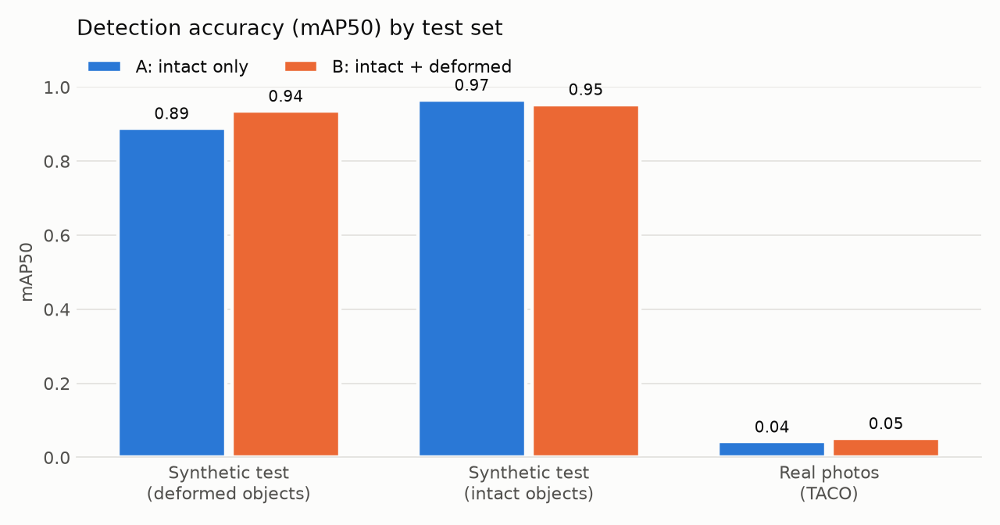
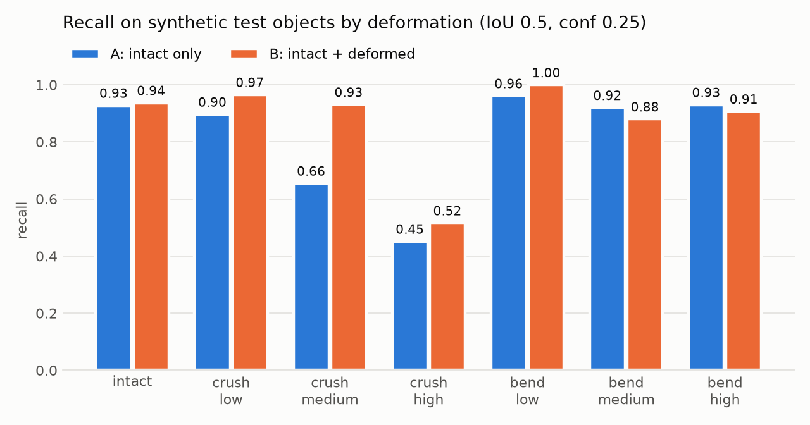
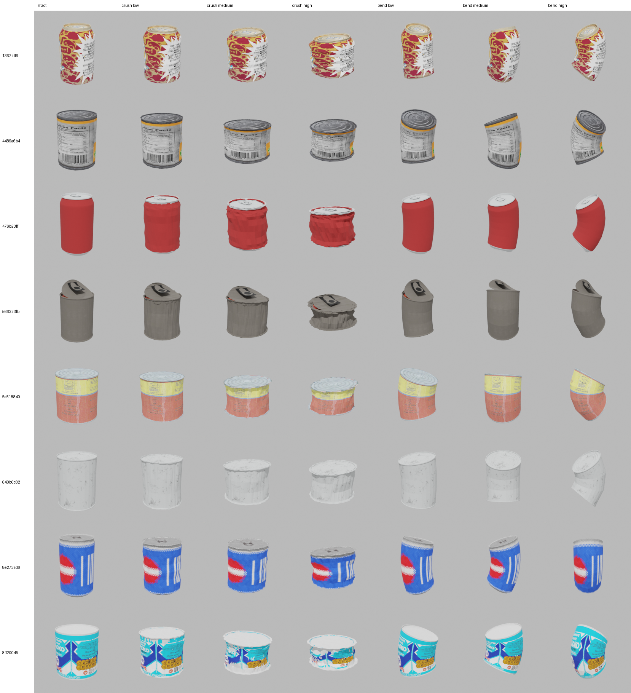
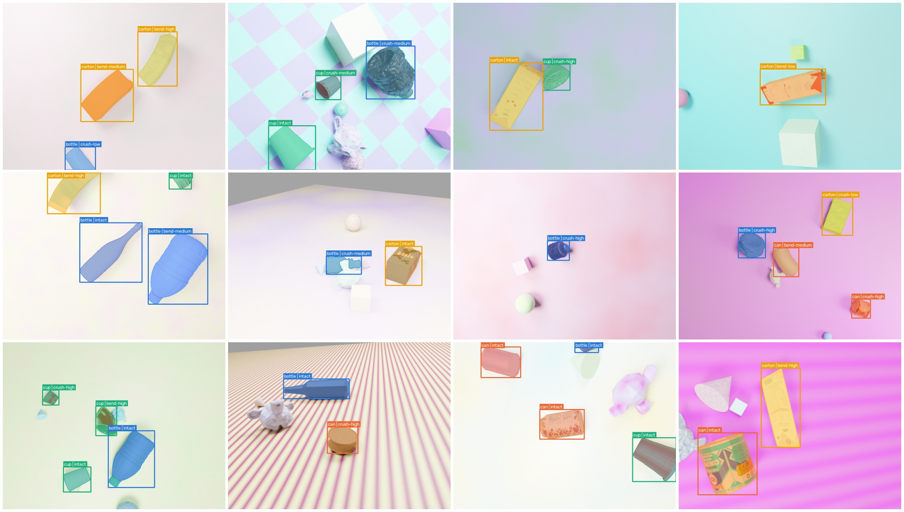

# Synthetic Deformable Waste Data Generation For Sim-to-Real Perception

**AI512 – Project 2**

Waste-sorting robots must recognise bottles, cans, cups and cartons that are **crushed,
dented or bent**. Labelled real photos of deformed waste are scarce, and 3D asset libraries
contain almost only *intact* objects. This project builds a reproducible pipeline that

1. takes intact 3D models of **4 waste classes** (bottle, can, cup, carton) from **Objaverse**,
2. **procedurally deforms** them (crush, bend) at three controlled severity levels,
3. renders domain-randomised scenes with **BlenderProc**, producing images with exact
   **COCO masks/boxes and YOLO labels** plus per-object deformation metadata,
4. trains two **YOLO11n** detectors in a controlled experiment:
   **A** = trained on intact objects only, **B** = same scenes with deformed objects,
5. evaluates both on synthetic test scenes and on real litter photos (**TACO**) to measure
   whether synthetic deformation improves **sim-to-real** detection.

**Research question:** does adding procedurally deformed objects to synthetic training data
improve detection of real-world deformed waste?

## Classes

| YOLO id | Class | Objaverse source | Real TACO categories (test) |
|---|---|---|---|
| 0 | bottle | LVIS bottle, water/beer/wine_bottle | Clear plastic bottle, Glass bottle, Other plastic bottle |
| 1 | can | LVIS can, beer_can | Drink can, Food Can |
| 2 | cup | LVIS cup, Dixie_cup + name search (paper/plastic/coffee cup) | Disposable plastic cup, Foam cup, Paper cup, Other plastic cup |
| 3 | carton | LVIS carton + name search (milk carton, juice box, ...) | Drink carton, Other carton |

## Pipeline

```
Objaverse ──download──► raw/ ──normalize──► normalized/ ──deform──► deformed/      (assets/models/)
                                                    │                    │
                                                    └────────┬───────────┘
                                                      generate_scenes (BlenderProc)
                                     ┌───────────────────────┴──────────────────────┐
                           data/synthetic/A_intact                    data/synthetic/B_deformed
                           (same scenes, all intact)                  (~60 % deformed)
                                     │ coco_to_yolo                                  │
                                     ▼                                               ▼
                               train model A                                   train model B
                                     └──────────────► evaluate ◄─────────────────────┘
                                         synthetic test (A, B)  +  real TACO (data/real/taco)
                                                         │
                                                    make_report ──► outputs/figures, outputs/results
```

**Run everything with one command:**

```bash
.venv/bin/python run_pipeline.py --stages all          # ~6-7 h on an M2 Pro
.venv/bin/python run_pipeline.py --from train          # only training + evaluation + report
.venv/bin/python run_pipeline.py --stages all --dry-run  # show the commands
```

All settings (classes, sizes, deformation ranges, dataset size, training) live in
**`configs/pipeline.yaml`**. Each stage writes a log to `logs/<stage>.log`.

| Stage | Script | What it does | Output |
|---|---|---|---|
| download | `src/download_objaverse.py` | LVIS + name-search candidates, CC-BY/CC0 only, name/size filters, class shape check | `assets/models/raw/<class>/*.glb`, `LICENSES.csv` |
| normalize | `src/normalize.py` | single mesh, upright, real height (bottle 25, can 12, cup 10, carton 20 cm), origin at base | `assets/models/normalized/` |
| deform | `src/deform.py` (Blender) | crush (Lattice + folds + Displace) and bend (SimpleDeform), low/medium/high, 2 variants, seeded | `assets/models/deformed/` (.obj + .json params) |
| model_grid | `src/render_model_grid.py` | every model at every level | `outputs/figures/model_grid_<class>.png` |
| render | `src/generate_scenes.py` (BlenderProc) | random floor, 1-4 targets, 0-6 distractors, random materials/lights, physics drop, top-down/oblique cameras, automatic masks | `data/synthetic/<dataset>/coco_data/`, `instance_metadata.csv`, `scene_metadata.jsonl` |
| yolo | `src/coco_to_yolo.py` | YOLO labels, 80/10/10 split by scene (no leakage, identical for A and B) | `data/synthetic/<dataset>/yolo/` |
| visualize | `src/visualize_annotations.py` | mask/box overlays, statistics | `outputs/figures/annotation_grid_<dataset>.jpg` |
| taco | `src/prepare_taco.py` | download TACO, map categories to our classes, fix orientation | `data/real/taco/` |
| train | `src/train_yolo.py` | YOLO11n, 60 epochs, 640 px, Apple GPU (MPS) | `train/runs/<dataset>/`, `train/weights/<dataset>.pt` |
| evaluate | `src/evaluate.py` | P/R/mAP overall + per class on 3 test sets, recall by deformation level, prediction examples | `outputs/results/*.csv`, `outputs/figures/predictions_*.jpg` |
| report | `src/make_report.py` | result charts + tables | `outputs/figures/results_*.png`, `outputs/results/results.md` |

### Deformation model

| Type | Method (Blender) | low | medium | high |
|------|------------------|-----|--------|------|
| **crush** | Lattice squash + barrel bulge + per-ring offsets + top tilt, diagonal accordion folds, Displace noise | 10–25 % height loss | 25–50 % | 50–75 % |
| **bend** | SimpleDeform BEND around a pivot at 35–65 % height, random direction | 15–35° | 35–60° | 60–90° |

### Datasets A and B (the controlled experiment)

Every scene is generated from its own seed `(seed, scene index)`, and the random draws do
not depend on the deformation probability. Scene *k* in **A_intact** and in **B_deformed** therefore has
the same floor, lights, cameras, models and distractors; the only difference is that targets
deformed in B are intact in A. Training the same detector on each isolates the effect of
deformation.

## Folder structure

```
AI-Project/
├── README.md, requirements.txt, run_pipeline.py, run_blenderproc.sh
├── configs/pipeline.yaml          all settings
├── docs/plan.md, docs/references.md
├── report/report.tex, report.pdf  LaTeX project report (latexmk -pdf report.tex)
├── assets/models/{raw,normalized,deformed}/<class>/, LICENSES.csv
├── src/                           one script per stage + config.py, mesh_utils.py
├── data/synthetic/A_intact/       1200 images, COCO + YOLO (intact)
├── data/synthetic/B_deformed/     1200 images, COCO + YOLO (deformed)
├── data/synthetic/pilot_50/       earlier 2-class pilot (archived)
├── data/real/taco/                real test set (1500 TACO photos)
├── train/runs/, train/weights/    YOLO11n runs and best weights
├── outputs/figures/, outputs/results/
└── logs/
```

## Setup

```bash
cd ~/Desktop/AI-Project
python3.11 -m venv .venv && .venv/bin/pip install -r requirements.txt
# BlenderProc downloads Blender 4.2.1 to ~/blender on first use. On macOS it cannot write
# inside the signed Blender.app bundle, so an unbundled copy is used:
ditto ~/blender/blender-4.2.1-macos-arm64/Blender.app ~/blender/blender-4.2.1-unbundled
ln -s Contents/Resources/4.2 ~/blender/blender-4.2.1-unbundled/4.2
.venv/bin/blenderproc pip install pillow pyyaml --custom-blender-path ~/blender/blender-4.2.1-unbundled
```

## Results

See `outputs/results/results.md` (filled in by the pipeline) and the summary below.

### Summary (YOLO11n, 60 epochs, 640 px, 1200 images per dataset)

| Test set | Model A (intact only) mAP50 | Model B (+ deformed) mAP50 | Change |
|---|---|---|---|
| Synthetic test, deformed objects (120 imgs, 294 objects) | 0.889 | **0.936** | +0.047 |
| Synthetic test, intact objects (same scenes) | **0.965** | 0.953 | −0.012 |
| Real TACO photos (1500 imgs, 1026 objects) | 0.042 | **0.051** | +0.009 (+22 % rel.) |

**Recall by deformation** (synthetic test, IoU 0.5, conf 0.25):

| | intact | crush low | crush medium | crush high | bend low | bend medium | bend high |
|---|---|---|---|---|---|---|---|
| A | 0.93 | 0.90 | 0.66 | 0.45 | 0.96 | 0.92 | 0.93 |
| B | 0.94 | 0.97 | **0.93** | 0.52 | 1.00 | 0.88 | 0.91 |

**Real TACO, AP50 per class (A → B):** bottle 0.017 → 0.032, can 0.068 → 0.072,
cup 0.057 → 0.068, carton 0.026 → 0.034. B is higher for all four classes; recall rises
from 0.112 to 0.137.

**Interpretation**

1. Training on deformed objects clearly helps on deformed objects: the detector trained only
   on intact models misses many crushed items (recall 0.66 at medium and 0.45 at high crush),
   model B recovers most of them (0.93 at medium crush), while staying almost equal on intact
   objects (−0.012 mAP50). Bending barely affects detection; crushing is what matters.
2. On real photos, B beats A overall and on every class, consistent with the hypothesis, but the
   absolute scores are very low (mAP50 ≈ 0.05): the sim-to-real gap (clean renders, 8 models
   per class, no dirt or natural backgrounds) dominates. With one training run per model the
   real-photo improvement is small and not statistically established.
3. Next steps that target the gap: realistic backgrounds (photo/HDRI textures of ground,
   grass, gravel), dirt and label-damage textures, more source models, a mix of a small amount
   of real data, multiple seeds for significance.

Figures: `outputs/figures/results_map50.png`, `results_recall_deformation.png`,
`results_taco_per_class.png`, `predictions_taco.jpg`, `predictions_synthetic.jpg`;
training curves in `train/runs/<run>/results.png`; confusion matrices in
`outputs/results/val/<model>_on_<test set>/`.







## Known limitations

- 8 source models per class: limited shape/texture variety (few clean, CC-licensed cups and
  cartons exist in Objaverse).
- Deformation is geometric (modifiers), not a physical crushing simulation; glass bottles are
  crushed like plastic and a few models show inner surfaces at high crush.
- Renders are cleaner than real photos (no dirt, clutter, natural backgrounds), so a large
  sim-to-real gap on TACO is expected.
- TACO has no deformation labels, so recall by deformation level is measured on synthetic data only.
- TACO's "Other carton" also contains non-drink cardboard; cup and carton test counts are small
  (186 and 138 objects), so their per-class scores are noisy.
